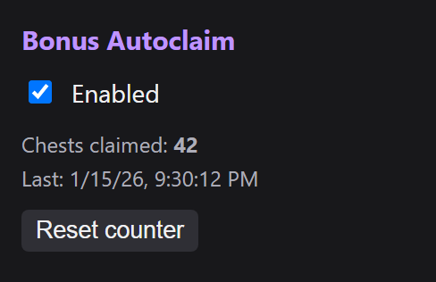
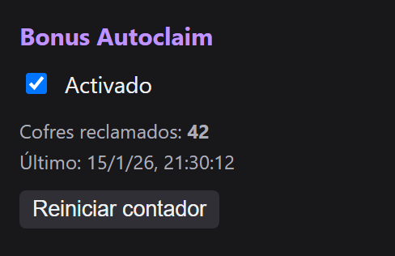

  

<h1 align="center">Twitch Bonus Autoclaim</h1>

  Tiny Chromium extension (Manifest V3) that automatically claims the Twitch channel points bonus chest.

  

## Features
- **No telemetry, no network requests.** The code never calls `fetch`, `XMLHttpRequest` or anything similar.
- **Only runs on `www.twitch.tv`.** Permissions: `storage` (on/off toggle and counter, stored locally) and `scripting` (re-inject into already open Twitch tabs after install/reload).
- Works in background tabs and other windows.
- Random 0.8–2.5 s delay before clicking.
- English / Spanish UI, following the browser language.
- No third-party libraries or dependencies.

## Install
1. Download or clone this repository.
2. Open `chrome://extensions` (also works on Edge, Brave, Opera…).
3. Enable **Developer mode**.
4. Click **Load unpacked** and select the folder.

Click the extension icon to toggle it and see how many chests it has claimed.

> If Chrome's Memory Saver discards the Twitch tab, nothing can run. Add `twitch.tv` to the "always keep active" list in `chrome://settings/performance`.

## Disclaimer
This project is not affiliated with or endorsed by Twitch. The author is not responsible for how the extension is used or for any consequences on your Twitch account. Use it at your own risk.

## License
[MIT](LICENSE) © 2026 Dreex

Made by **Dreex**.

---

🇪🇸 Español

  

Extensión pequeña para navegadores Chromium (Manifest V3) que reclama automáticamente el cofre de puntos de canal de Twitch.

### Características
- **Sin telemetría ni peticiones de red.** El código nunca usa `fetch`, `XMLHttpRequest` ni nada parecido.
- **Solo funciona en `www.twitch.tv`.** Permisos: `storage` (interruptor y contador, guardados localmente) y `scripting` (reinyectar en las pestañas de Twitch ya abiertas al instalar o recargar).
- Funciona en pestañas en segundo plano y en otras ventanas.
- Espera aleatoria de 0,8–2,5 s antes de pulsar.
- Interfaz en inglés / español según el idioma del navegador.
- Sin bibliotecas ni dependencias de terceros.

### Instalación
1. Descarga o clona este repositorio.
2. Abre `chrome://extensions` (también vale en Edge, Brave, Opera…).
3. Activa el **Modo de desarrollador**.
4. Pulsa **Cargar descomprimida** y elige la carpeta.

Pulsa el icono de la extensión para activarla o desactivarla y ver cuántos cofres ha reclamado.

> Si el Ahorro de memoria de Chrome descarga la pestaña de Twitch, no se puede ejecutar nada. Añade `twitch.tv` a la lista de sitios siempre activos en `chrome://settings/performance`.

### Aviso
Este proyecto no está afiliado ni respaldado por Twitch. El autor no se hace responsable del uso que se haga de la extensión ni de las consecuencias en tu cuenta de Twitch. Úsala bajo tu propia responsabilidad.

### Licencia
[MIT](LICENSE) © 2026 Dreex

Hecho por **Dreex**.

